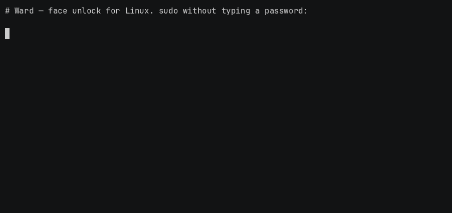
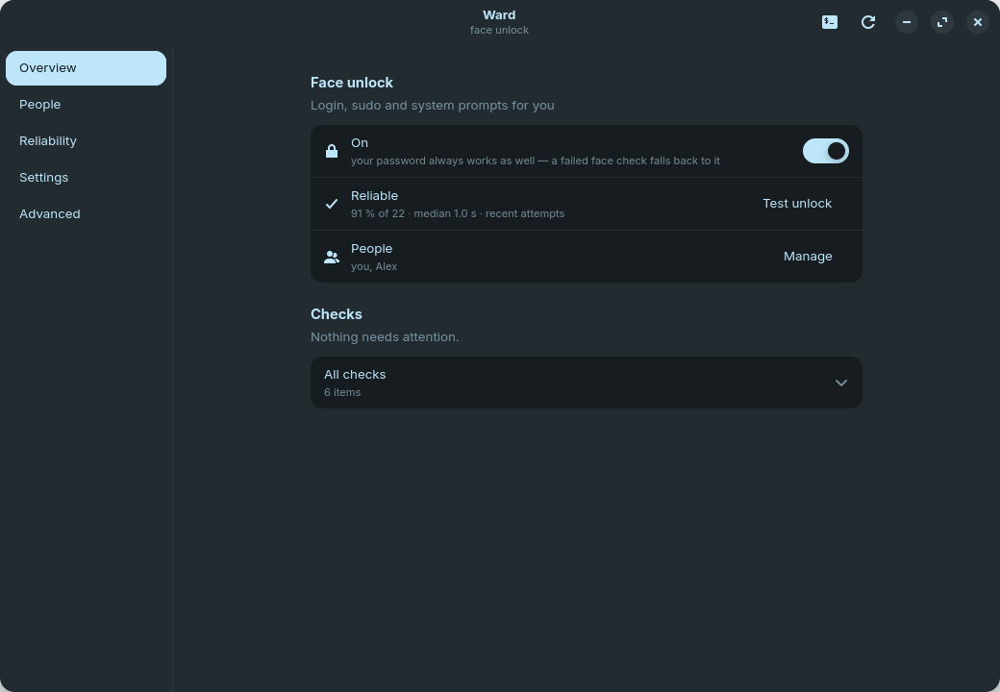
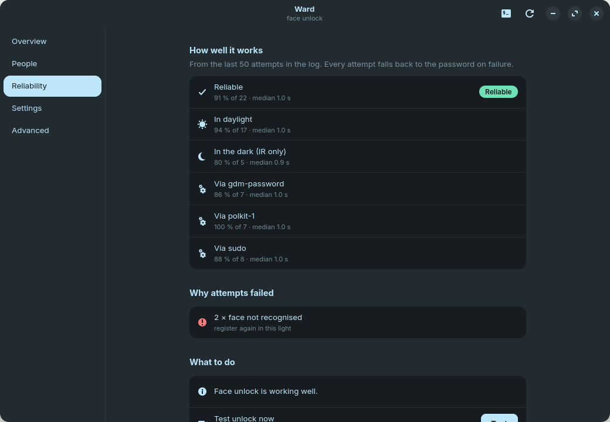

# Ward

### Secure, open-source face unlock for Linux.

[](https://github.com/0ctave/ward/actions/workflows/tests.yml)
[](https://github.com/0ctave/ward/actions/workflows/codeql.yml)
[](LICENSE)


Ward logs you into **login, `sudo` and system prompts with your face** — using your laptop's
infrared + colour cameras, backed by real liveness checks, on native Wayland. It's built on your
distro's own Python (no pip), and it **always falls back to your password**. Free and open source.

**[Install](docs/install.md)** · **[Usage](docs/usage.md)** · **[How it works](docs/how-it-works.md)** · **[Security](SECURITY.md)** · **[Roadmap](docs/ROADMAP.md)**

<!-- Hero demo (face-free terminal screencast): run docs/assets/record_demo.sh, then uncomment -->
<!--  -->

<p align="center">
  
  
</p>

---

## Why Ward

[Howdy](https://github.com/boltgolt/howdy) brought Windows-Hello-style face login to Linux, but out
of the box it's unreliable — and the reasons have nothing to do with face recognition. It opens the
wrong camera, never switches on the infrared emitter, treats one enrolled pose as one working head
angle, and ships defaults from a 2018 webcam. The result is "works sometimes," which for
authentication is the worst outcome.

Ward ships **its own engine** (on the same proven pieces — dlib, OpenCV, V4L2) and fixes the setup
instead of the algorithm: it finds and lights the IR emitter, enrolls many poses in one guided
sweep, measures the match threshold from *your* face, adds liveness, and tells you exactly what it's
doing. And it never locks you out — every failure falls through to the password.

## Features

- 🌙 **Works in the dark.** Uses the infrared camera and turns on its emitter, so it sees you at
  midnight the same as at noon.
- 🛡️ **Real liveness, honest about it.** A phone or monitor emits no infrared, so a replayed face is
  absent from the IR frame and rejected; an anti-spoof CNN and a motion check back that up. It's
  strong convenience — [not Face ID](docs/how-it-works.md#honest-limits), and it says so.
- 🎯 **Thresholds measured, not guessed.** One guided enrollment captures several poses *and* sets
  the recognition gate from held-out frames of your own face.
- 🖥️ **A real app, or a real CLI.** A native GTK 4 / libadwaita window for setup, people and
  reliability — or do everything from the terminal, including headless over SSH.
- ⚡ **Fast.** A sandboxed resident engine keeps the models loaded, so an unlock starts ~1 s sooner.
- 🔓 **Unlocks your keyring**, logs **every attempt**, supports **several people per login**, and
  adapts to **glasses / headset / night**.
- 🐧 **Distro Python, zero pip deps.** Tested on Debian, Ubuntu, Fedora, Arch and openSUSE.

## Quick start

```bash
# 1. Dependencies (Debian/Ubuntu shown — see the Install guide for Fedora/Arch/openSUSE)
sudo apt install python3-opencv python3-gi python3-gi-cairo gir1.2-adw-1 gcc libc6-dev

# 2. Install Ward
git clone https://github.com/0ctave/ward && cd ward
sudo ./install.sh

# 3. Set it up — open "Ward" from your apps (or run `ward`) and follow the guided wizard
ward
```

That's it: the app walks you through cameras → infrared → registering your face → turning it on, all
in one window. Prefer the terminal (or on a server)? `sudo ward setup` does the same thing, and it
works headless. Full details, per-distro dependencies, the dlib-vs-ArcFace choice and troubleshooting
are in the **[Install guide](docs/install.md)**.

> [!NOTE]
> Ward is at its best on a laptop with a **Windows Hello infrared camera** (most 2019+
> business/premium models). A plain colour webcam works too, just without infrared liveness and
> night unlock.

## Documentation

| Guide | What's in it |
|---|---|
| **[Install](docs/install.md)** | Prerequisites, per-distro dependencies, the recogniser choice, distro packages, headless, uninstall, troubleshooting. |
| **[Usage](docs/usage.md)** | The app, everyday tasks (people, glasses, keyring, policy, speed), headless/SSH, and the full command reference. |
| **[How it works](docs/how-it-works.md)** | Why Linux face unlock is unreliable and how Ward fixes each part — IR, emitter, poses, measured thresholds, liveness, and the honest limits. |
| **[Security](SECURITY.md)** | Threat model, what's in and out of scope, the fail-open guarantee, and how to report a vulnerability. |
| **[Design](docs/DESIGN.md)** · **[Roadmap](docs/ROADMAP.md)** | Full rationale and thresholds · what's planned next. |

## Security & limits, up front

Ward is a **2D** face system — no depth sensor. It defeats phone-screen photos and darkness; it does
**not** claim to defeat a high-quality printed infrared photograph, and identical twins defeat any 2D
system. Treat it as **strong convenience with a password fallback** — the class of Windows Hello on
the same hardware, not Face ID. No false-accept *rate* is certified yet. See
[How it works → Honest limits](docs/how-it-works.md#honest-limits) and [SECURITY.md](SECURITY.md).

## Contributing

Issues and PRs welcome — especially **camera quirks from other laptops** (attach your `ward doctor`
output) and portability fixes. Start with [CONTRIBUTING.md](CONTRIBUTING.md) and the
[Code of Conduct](CODE_OF_CONDUCT.md).

## License

[MIT](LICENSE) © 2026 octave. The bundled YuNet and MiniFASNetV2 models are Apache-2.0
(see `ward/models/`).
